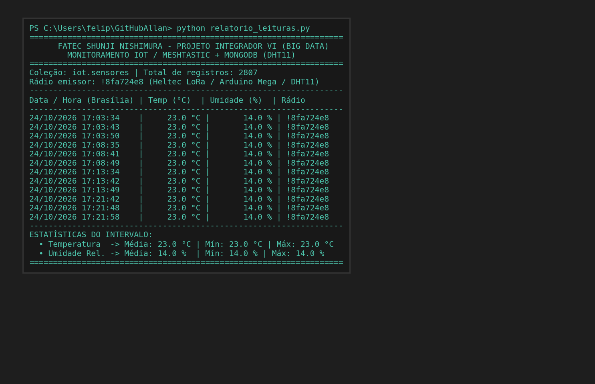

# Do Pacote Bruto ao Dado Útil: Leituras de Sensores com Meshtastic e MongoDB

**Autor:** Felipe  
**Disciplina:** Projeto Integrador VI - Big Data no Agronegócio  
**Instituição:** Fatec Shunji Nishimura Pompeia  
**Orientador:** Prof. Allan Siriani, PhD  

---

## 📌 Introdução

No desenvolvimento de soluções de IoT voltadas para o monitoramento agropecuário e ambiental, a conectividade é um dos principais desafios em áreas remotas. Neste projeto integrador, implementamos um pipeline completo de ponta a ponta: desde a captura de grandezas físicas no campo até a persistência estruturada e análise em banco de dados NoSQL (**MongoDB**).

---

## 🛠️ Arquitetura do Pipeline de Dados

O fluxo dos dados segue a seguinte cadeia tecnológica:

```
[ Sensor DHT11 ] 
       │ (Sinais Analógicos/Digitais de Temp e Umidade)
       ▼
[ Arduino Mega ]
       │ (Comunicação Serial UART)
       ▼
[ Heltec LoRa - Meshtastic (!8fa724e8) ]
       │ (Transmissão em malha LoRa Off-Grid)
       ▼
[ Gateway Meshtastic / Broker MQTT ]
       │ (Tópicos: sensores/tempUmid/2/json/mqtt_teste/!8fa724e8)
       ▼
[ Serviço de Ingestão no Servidor ]
       │ (Parsing do JSON e Enriquecimento de Metadados)
       ▼
[ MongoDB (Database: iot | Coleção: sensores) ]
       │
       ├──> Visualização via MongoDB Compass
       └──> Scripts de Consulta & Análise em Python (PyMongo)
```

---

## 🔍 Do Payload Bruto ao Documento Tratado

As leituras enviadas pelo rádio chegam com formato padronizado pelo Meshtastic. No MongoDB, o documento é estruturado da seguinte forma:

```json
{
  "_id": ObjectId("6ada2db7e61373062a68bf1a"),
  "topic": "sensores/tempUmid/2/json/mqtt_teste/!8fa724e8",
  "payload": "{\"channel\":0, ...}",
  "payload_data": {
    "sender": "!8fa724e8",
    "type": "text",
    "payload": {
      "t": 21,
      "u": 15
    },
    "timestamp": 1792683446
  },
  "received_at": ISODate("2026-10-23T10:51:10.043Z")
}
```

* **Filtro de Telemetria:** Como a malha pode trafegar pacotes de controle ou nós sem dados válidos, filtramos registros com `"payload_data.payload.t": { $exists: true }`.
* **Tratamento Temporal:** O campo `received_at` carimba o momento exato de chegada ao servidor (em UTC), sendo convertido para o fuso local (`America/Sao_Paulo`, UTC-3).

---

## 📊 Consultas e Resultados (Prints das Leituras)

### 1. Escuta Contínua e Últimas Leituras via Python (`relatorio_leituras.py` e `consulta_mongo.py`)

Execução do script que se conecta ao MongoDB via `pymongo` e filtra em tempo real as telemetrias válidas do rádio:

```bash
python relatorio_leituras.py
```



> **Figura 1:** Terminal exibindo as leituras de Temperatura e Umidade recebidas do nó Meshtastic `!8fa724e8` e gravadas no MongoDB.
> ```text
> --------------------------------------------------------------------
> Data / Hora (Brasília) | Temp (°C)  | Umidade (%)  | Rádio     
> --------------------------------------------------------------------
> 24/10/2026 17:08:49    |     23.0 °C |       14.0 % | !8fa724e8 
> 24/10/2026 17:13:34    |     23.0 °C |       14.0 % | !8fa724e8 
> 24/10/2026 17:13:42    |     23.0 °C |       14.0 % | !8fa724e8 
> 24/10/2026 17:21:42    |     23.0 °C |       14.0 % | !8fa724e8 
> 24/10/2026 17:21:58    |     23.0 °C |       14.0 % | !8fa724e8 
> --------------------------------------------------------------------
> ESTATÍSTICAS DO INTERVALO:
>   • Temperatura  ->  Média: 23.00 °C | Mín: 23.0 °C | Máx: 23.0 °C
>   • Umidade Rel. ->  Média: 14.00 %  | Mín: 14.0 % | Máx: 14.0 %
> ```

---

### 2. Consulta Estruturada via MongoDB Compass / mongosh

Utilizando queries para isolar apenas as telemetrias do nó transmissor:

```javascript
db.sensores.find(
  { "payload_data.sender": "!8fa724e8", "payload_data.payload.t": { $exists: true } },
  { _id: 0, received_at: 1, temp: "$payload_data.payload.t", umid: "$payload_data.payload.u" }
).sort({ _id: -1 }).limit(10)
```

> **[INSERIR PRINT 2 AQUI: Interface do MongoDB Compass exibindo a coleção `iot.sensores` com o filtro aplicado]**

---

### 3. Agregação Temporal (Média, Mínimo e Máximo por Hora)

Pipeline de agregação calculando métricas horárias em fuso horário de Brasília:

```javascript
db.sensores.aggregate([
  { $match: { "payload_data.sender": "!8fa724e8", "payload_data.payload.t": { $exists: true } } },
  { $group: {
      _id: { $dateToString: { date: "$received_at", format: "%Y-%m-%d %H:00", timezone: "America/Sao_Paulo" } },
      media_temp: { $avg: "$payload_data.payload.t" },
      min_temp:   { $min: "$payload_data.payload.t" },
      max_temp:   { $max: "$payload_data.payload.t" },
      media_umid: { $avg: "$payload_data.payload.u" },
      total_leituras: { $sum: 1 }
  } },
  { $sort: { _id: -1 } }
])
```

> **[INSERIR PRINT 3 AQUI: Resultado da agregação agrupando médias por hora]**

---

## 💡 Considerações Finais

A integração do ecossistema Meshtastic com brokers MQTT e MongoDB demonstra como redes LoRa mesh podem fornecer infraestrutura resiliente e de baixo custo para sensoriamento remoto. O armazenamento em documentos semiestruturados confere a flexibilidade necessária para acomodar novos tipos de nós e sensores sem a rigidez de esquemas tradicionais.

---

### 🏷️ Hashtags para o LinkedIn:
`#BigData` `#IoT` `#MongoDB` `#Meshtastic` `#EngenhariaDeDados` `#ProjetoIntegrador` `#Fatec` `#Agronegocio`
